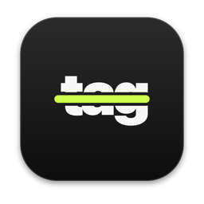
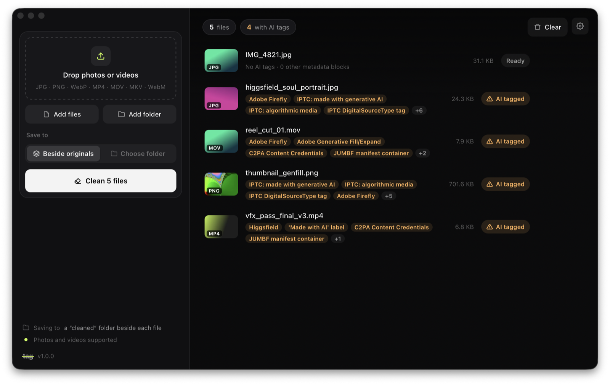
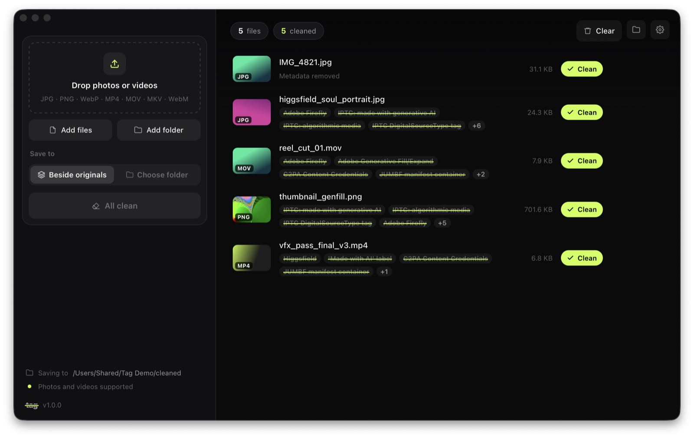

<p align="center">
  
</p>

<h1 align="center">tag</h1>

<p align="center">
  <b>Take the AI tags off your photos and videos.</b><br>
  Strips C2PA Content Credentials, "made with AI" labels and generator metadata.<br>
  Lossless, on your own computer, for macOS and Windows.
</p>

<p align="center">
  <a href="https://github.com/YuvrajxGarg/tag/releases/latest"></a>
  
  <a href="LICENSE"></a>
</p>

<p align="center">
  
</p>

## Why

AI tools stamp their output with metadata, and platforms such as YouTube and Instagram read it. When you use AI for one VFX pass, a cleanup or an extend, those stamps ride along on work that's mostly yours. Tag removes them without touching a single pixel.

## Download

| Platform | Download | First launch |
|---|---|---|
| **macOS** 11+ · Apple silicon | [**Tag-mac.zip**](https://github.com/YuvrajxGarg/tag/releases/latest/download/Tag-mac.zip) | Unzip and move **Tag** to Applications. The app isn't notarized, so the first time: right-click → **Open**. On macOS 15 and later, go to **System Settings → Privacy & Security → Open Anyway** instead. |
| **Windows** 10 / 11 · 64-bit | [**Tag-windows.zip**](https://github.com/YuvrajxGarg/tag/releases/latest/download/Tag-windows.zip) | Unzip the **Tag** folder somewhere you own (Documents, Desktop) and run **Tag.exe**. If SmartScreen appears, click **More info → Run anyway**. |

ffmpeg comes bundled, so there's nothing else to install. Tag checks this repository for new releases and updates itself.

## How it works

1. **Drop** photos, videos or whole folders onto the window.
2. **See** what each file carries: Higgsfield, Adobe Firefly, Generative Fill, C2PA manifests, IPTC AI labels, and more.
3. **Clean.** Tag writes clean copies to a `cleaned` folder beside the originals, or to a folder you choose. Originals are never modified.

<p align="center">
  
</p>

## What it removes

| | Photos (JPG, PNG, WebP) | Videos (MP4, MOV, MKV, WebM) |
|---|---|---|
| **C2PA / Content Credentials** | JUMBF manifests (APP11, `caBX`, `C2PA` chunks) | Top-level C2PA `uuid` box |
| **AI labels** | IPTC `DigitalSourceType = trainedAlgorithmicMedia` | Container comments, encoder and handler tags |
| **Edit history** | XMP, EXIF, Photoshop IRB, comments, trailing data | Global and per-stream metadata, chapters |

It recognises tags from **Higgsfield, Adobe Firefly / Photoshop / Premiere, OpenAI, Midjourney, Stable Diffusion, Runway, Kling and Google** tools, plus anything carrying a C2PA manifest.

## What it keeps

- **Every pixel and every audio and video frame, bit for bit.** Images are rewritten at the container level and videos are remuxed with stream copy, so nothing is re-encoded.
- **Colour profiles, orientation and rotation, transparency, animation, HDR signalling.**

## Features

- **Lossless, batch and drag-and-drop.** Scan hundreds of files at once.
- **Before and after.** Every file shows the tags it had, struck through once they're removed.
- **Auto-updates.** Checks GitHub Releases, downloads in the background, verifies the SHA-256 checksum, and installs when you quit or with one click.
- **Command line, too:**

  ```bash
  Tag scan  ~/Desktop/exports
  Tag clean ~/Desktop/exports -o ~/Desktop/ready-to-post
  ```

  On macOS the binary lives at `Tag.app/Contents/MacOS/Tag`. From source, run `python Tag.py …`.

## Limits

- **Metadata only.** Some generators also hide an invisible watermark *in the pixels themselves*, such as Google's SynthID. That isn't metadata, so Tag doesn't touch it, and platforms can still run their own classifiers on the content.
- **Platform rules still apply.** YouTube asks creators to disclose realistic content that was meaningfully made or altered with AI. It says production help (VFX cleanup, colour, backgrounds) generally doesn't need disclosure, and the label doesn't affect monetization by itself. Tag keeps leftover metadata from mislabelling your work. It isn't a replacement for disclosing when the rules require it.

## Build from source

You need Python 3.9+. On macOS, [uv](https://docs.astral.sh/uv/) is the easiest way to get it.

```bash
pip install -r requirements.txt
```

```bash
python Tag.py
```

| | |
|---|---|
| **macOS app** | `./build_mac.sh` builds `dist/Tag.app`. Add `--install` to copy it to `~/Applications`. |
| **Windows app** | `build_windows.bat` builds `dist\Tag\Tag.exe`. |
| **Tests** | `python -m unittest discover tests` |

### Layout

```
aitagremover/core.py      detection + lossless stripping (JPEG, PNG, WebP, ISO-BMFF/Matroska via ffmpeg)
aitagremover/webapp.py    the window: HTML/CSS UI in a native WebKit / WebView2 view (pywebview)
aitagremover/updater.py   GitHub Releases updater (check → download → verify → swap)
aitagremover/ui/          the interface
Tag.spec                  PyInstaller recipe for both platforms
```

## Releasing

1. Bump `VERSION` and commit.
2. Tag and push:

   ```bash
   git tag v1.0.1 && git push origin v1.0.1
   ```

3. The **Release** workflow builds, tests and smoke-tests both apps, then attaches `Tag-mac.zip` and `Tag-windows.zip` (each with a `.sha256`) to the release. Installed copies pick it up on their next update check.

## License

[MIT](LICENSE). Release builds bundle [FFmpeg](https://ffmpeg.org) via [imageio-ffmpeg](https://github.com/imageio/imageio-ffmpeg).
